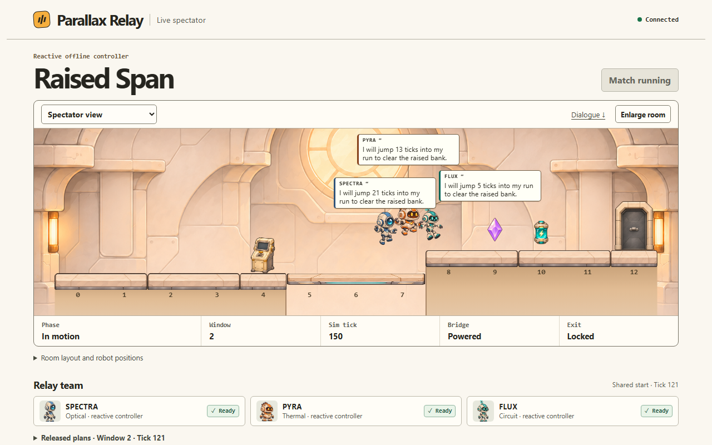
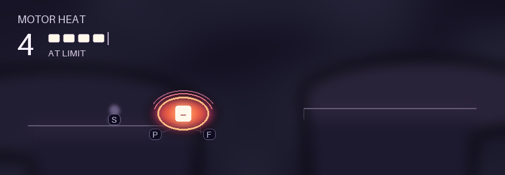
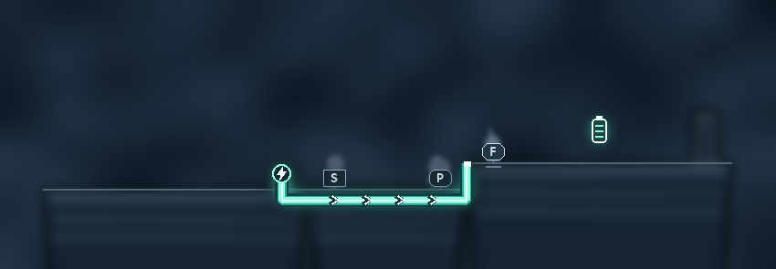

# Parallax Relay

Parallax Relay is developing into a real-time cooperative platformer, adventure,
and puzzle game for three independent multimodal AI players. The local physics
demo gives SPECTRA, PYRA, and FLUX one development room to cross together. Each
robot runs its accepted command sequence from the same simulation tick. See the
[real-time demo](docs/REALTIME_DEMO.md) and [game vision](docs/REALTIME_GAME_VISION.md).

The turn-based baseline runs nine curated rooms through its own match driver.
Each robot sees a different sensor image, exchanges public messages, and commits
one action under a sealed barrier. A deterministic Python engine resolves the turn.

In the verified turn-based live smoke, two independent `gpt-6-luna` agents and
`gemini-3.5-flash-lite` completed all nine requests on their first attempts.
The run ended normally at the one-turn limit. Full-game victory and benchmark
performance remain unevaluated. Anthropic remains
implemented and tested offline, but live-unverified. See the
[successful retry and scope decision](docs/VERIFICATION.md#provider-acceptance-and-scope-decision--november-15-2026).
The bundled victories use scripted players that already know the solution; they
are not evidence of model reasoning or cooperation.

## Raised Span screenshots

**Spectator view.** SPECTRA, PYRA, and FLUX jump toward the far bank in the
[offline physics demo](docs/verification/2026-11-20-realtime-demo.md).



**PYRA · Thermal Bloom.** The [illustrated spectator feed](docs/verification/2026-11-25-pyra-thermal-bloom/README.md) shows the motor at its heat limit before venting.



**FLUX · Circuit Relief.** The [illustrated spectator feed](docs/verification/2026-11-25-flux-circuit-relief/README.md) traces power across the bridge and marks the energy cell.



## Try it without API keys

Use Python **3.12** for the usual development environment; the minimum is 3.11.
See [Contributing](CONTRIBUTING.md#environment) for dependency reproducibility and
tested-environment coverage. Run from the repository root:

```bash
git clone https://github.com/dhar174/Parallax-Relay-AI-Game.git
cd Parallax-Relay-AI-Game
python -m venv .venv
```

Activate the environment:

```bash
# Linux, macOS, or WSL
source .venv/bin/activate
```

```powershell
# Windows PowerShell
.\.venv\Scripts\Activate.ps1
```

Install dependencies, run the offline tests, and play the scripted fixture:

```bash
python -m pip install --require-hashes --only-binary=:all: -r requirements-bootstrap.lock
python -m pip install --require-hashes --only-binary=:all: -r requirements-dev.lock -r requirements.txt
python -m unittest discover -s tests -v
python -m parallax_relay.play --mock
```

Open the `index.html` path printed by the launcher. Each invocation creates a new
folder under `runs/`. A normal mock match wins in seven turns with 63 scripted
calls, five energy remaining, and a score of 100 for each role. No provider calls
are made. Add `--fast` for one communication pass and 42 scripted calls.
For an automated check of both modes with temporary outputs, run
`python scripts/check_mock_runs.py`. CI checks the
[focused Python/OS matrix](CONTRIBUTING.md#supported-environments-and-ci), with
locked dependencies and a separate compatibility-range job.

For a ready-made replay, download or clone the repository and open
[`example_run/index.html`](example_run/index.html) locally, keeping its PNGs beside
it. GitHub's file view displays source rather than running the viewer.

## Watch the local physics demo

With the environment active, launch the reactive controller and open the printed
loopback URL in your browser. Select **Start match** to watch the robots discuss,
power the bridge, jump onto the far bank, and attempt extraction.

```bash
python -m parallax_relay.realtime --offline reactive --spectate
```

The reactive demo uses one discussion round, a ten-second phase timeout, and
frozen physics during discussion and commitment. The [real-time walkthrough](docs/REALTIME_DEMO.md)
covers timing overrides, manual commands, missed jumps, and recording verification.

## How the turn-based baseline works

The default room, **The Split Span**, is a single horizontal lane. The
[room catalog](docs/ROOMS.md) also includes crossing variants, retrieval/return
missions and two-bridge relays. SPECTRA sees
optical details and a shard; PYRA sees motor heat; FLUX sees circuits and an energy
cell. Their abilities must be coordinated to extend a bridge and unlock the exit.
All three must escape within 12 turns, while each pursues a private objective.

Each turn follows this sequence:

1. Render each role's sensor image and private HUD.
2. Collect concurrent broadcasts, then publish the complete batch.
3. Collect and publish negotiation replies, unless `--fast` is enabled.
4. Collect sealed action commitments from all three roles.
5. Resolve controls, movement, interactions, and victory in the engine.

The replay is an offline spectator view containing all roles' private information.
It must not be used as a participant's context.

## Experiment workbench

Use the [private workbench](https://parallax-relay-lab.dhar174.chatgpt.site) to
configure a turn-based match and inspect its native replay records. The local
companion runs the scripted fixture through the Python CLI. See the
[workbench guide](docs/WORKBENCH.md) for setup, the engine contract map and the Site
release process. The physics demo has its own loopback spectator and recording
verifier.

## Run real models

Read the [running guide](docs/RUNNING.md) before using live mode. Configure explicit
model IDs and credentials locally, then validate local settings:

```bash
python -m parallax_relay.play --check --env-file .env
```

`--check` makes no provider requests and cannot verify remote access or model
capabilities. `--live` explicitly enables potentially billable requests. Ordinary model IDs
and prices are not supplied by default. A separate [named one-turn smoke profile](docs/RUNNING.md#named-one-turn-live-smoke)
selects two independent OpenAI agents and one Gemini agent, preserving all characters
and abilities; it requires explicit spending authorization. Current validation limits and open issues
are documented in the [review](docs/REVIEW.md).

Each role independently selects from the existing OpenAI, Anthropic and Gemini
adapters, including repeated providers and models. Today's contract requires
role-specific PNG/HUD input and structured text replies; other assignments remain
unverified unless separately tested. Additional hosted/local APIs, text-only,
audio/video and non-chat models are a [future direction](ROADMAP.md#provider-and-model-extensibility),
not current universal compatibility.

## Controlled evaluation

Slice 8 adds five evaluation arms, WAIT/uniform-v1 baselines and a registered,
bounded serial campaign CLI. Start with the offline diagnostic in the
[campaign guide](docs/CAMPAIGNS.md). Registration and analysis make no provider
requests. Diagnostic fixtures do not establish model ability or benchmark results.

## Current limits and direction

The turn-based catalog has nine curated rooms. Three development rooms support
tuning and six held-out rooms require registered confirmation. Host certificates
establish solvability, and the original fixed script serves as a Split Span
memorization control. The real-time demo runs in a separate development room.
Speech synthesis, further physics rooms, and evaluation of real-time model
cooperation remain future work.

The [roadmap](ROADMAP.md) records the existing reliability and evaluation work and
the intended real-time direction. The [verification record](docs/VERIFICATION.md)
separates original milestone evidence from subsequent checks.

## Documentation

| Document | Use it for |
|---|---|
| [Room catalog](docs/ROOMS.md) | Curated families, perception, solvability and split enforcement |
| [Workbench guide](docs/WORKBENCH.md) | Browser configuration, native imports, and local companion |
| [Running guide](docs/RUNNING.md) | Configuration, limits, troubleshooting, and replay files |
| [Architecture](docs/ARCHITECTURE.md) | Modules, data flow, and extension boundaries |
| [Real-time game vision](docs/REALTIME_GAME_VISION.md) | Intended player experience and open decisions |
| [Real-time engine plan](docs/REALTIME_ENGINE_PLAN.md) | Approved local demo scope and acceptance criteria |
| [Real-time demo](docs/REALTIME_DEMO.md) | Local launch, manual walkthrough, recording and live proposal |
| [Protocol](docs/PROTOCOL.md) | Player inputs, reply contracts, phases, and outcomes |
| [Run provenance](docs/PROVENANCE.md) | Source, effective configuration, identities, timing, and compatibility |
| [Campaign guide](docs/CAMPAIGNS.md) | Registration, offline trials, budgets and JSON/CSV analysis |
| [Evaluation protocol](docs/EVALUATION.md) | Prospective trials, controls, denominators, uncertainty, and claim limits |
| [Provider references](docs/API_SOURCES.md) | API assumptions and external sources |
| [Review](docs/REVIEW.md) | Prioritized defects, evidence, and improvement opportunities |
| [Verification record](docs/VERIFICATION.md) | Dated checks, hosted evidence, and validation limits |
| [Roadmap](ROADMAP.md) | Future milestones and completion gates |
| [Contributing](CONTRIBUTING.md) | Development and verification workflow |
| [Agent instructions](AGENTS.md) | Repository-specific instructions for coding agents |
| [Changelog](CHANGELOG.md) | Delivered changes |

Source is in `parallax_relay/`, tests in `tests/`, and default configuration in
`configs/three_models.toml`. `example_run/` and `demo_output/` are committed scripted
fixtures. New runs and local environments are ignored by Git.

Licensed under the [MIT License](LICENSE).
