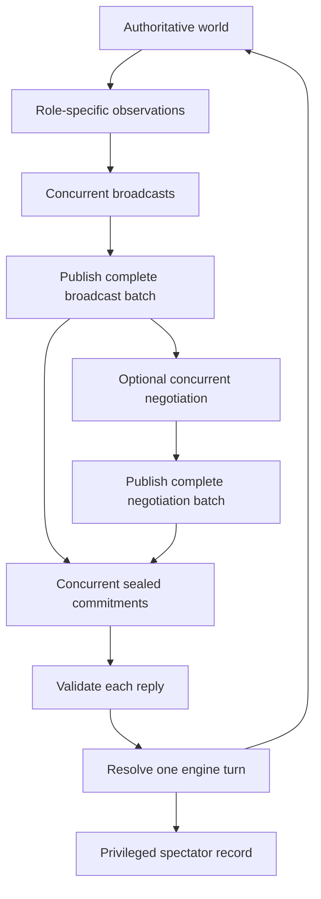

# Architecture

Parallax Relay is a local Python application with a static browser workbench and
an optional loopback mock companion. It has no hosted game-execution backend,
database, or agent framework. Pillow renders observations, Pydantic validates replies
and configuration, and httpx sends direct provider requests. The game engine
remains independent of the provider adapters.

## Modules and ownership

| Layer | Modules | Responsibility |
|---|---|---|
| Simulation | `state.py`, `engine.py` | Room state, legal consequences, scoring, terminal outcomes |
| Observation | `render.py`, `observations.py`, HUD/event helpers in `state.py` | Role-specific PNG and allowed text projection |
| Player contract | `protocol.py`, `prompts.py` | Immutable inputs, reply schemas, public rules |
| Players | `providers.py`, `agents.py`, `scripted.py` | REST adapters and explicit scripted control fixture |
| Match driver | `orchestrator.py`, `budget.py` | Phase barriers, retries, histories, reservations, stop reasons |
| Local interface | `config.py`, `play.py` | TOML/env resolution, CLI, provider-client ownership |
| Spectator output | `recording.py`, `replay_template.html` | Incremental logs, images, final summary, static viewer |
| Run identity | `provenance.py` | Versioned non-secret identities, canonical hashes, lifecycle, legacy-aware reader |
| Campaigns | `campaign.py`, `campaign_models.py`, `campaign_analysis.py` | Frozen schedules, serial execution/ledger/budgets, all-trial reporting |
| Legacy demo | `demo.py` | Direct scripted engine driver and older replay format |

All module names above are relative to `parallax_relay/`.

## Real-time development room

The `parallax_relay.realtime` package owns a separate fixed-step development
room. Its Python physics solver applies inputs, handles contacts and recovery,
and evaluates completion. The host paces the default 60 Hz simulation and owns
the window clock. At each window it samples all three role observations at one
tick, coordinates the phases and installs the sealed team programs on one shared
start tick. The default discussion clock freezes physics. The offline
comparison clock advances neutral physics while keeping the sample fixed and
submitted plans sealed. The renderer displays committed poses and events.
Browser frame timing cannot affect physics.

The real-time observation projection reuses the baseline PNG renderer. It gives
each player its own horizontal schematic and a versioned physics HUD. The
provider adapters use the selected request contract for instructions and output
shape. Local manual input goes through the real-time validator and scheduler.

The loopback spectator reads committed events through a cursor API and fetches
role feed PNGs by sampled window. It renders the scene in Canvas and DOM, with
public dialogue and room events. It is a privileged local view. The browser can
start or restart offline matches and submit controls in manual mode. Restart
replaces the session on the same server after the prior worker stops. Each
session has its own run ID, recording and manual request slots. On a server
that supports restart, start requests and sensor reads identify the intended
run so requests from a prior match cannot affect the next one.
See the [demo guide](REALTIME_DEMO.md) for the launch commands.

## One turn

The direct broadcast-to-commit path is fast mode. Every phase within a turn uses
the same initial observation; later phases add completed message batches. Within a
phase, `asyncio.gather` waits for all roles' bounded response paths. Faster players
and retries receive no other player's same-phase response.

Each request contains the role's own PNG, HUD, private objective, recent text
history, latest private notes, and completed public messages. Old PNGs are not
resent. Histories and notes are stored separately per role. When commitments finish,
the engine applies VENT before REROUTE, then movement, then collection/unlocking,
then victory or defeat. The input world is copied before mutation.

Model JSON shape failures may retry. Schema-valid illegal moves consume the turn;
they are not repaired into better moves. See [Protocol](PROTOCOL.md) for the exact
contract, including engine enforcement of zero parameters for non-MOVE actions.

## Trust boundaries

`observe(world, role)` is the standard engine-to-player boundary. The HUD is an
explicit projection; `WorldState.snapshot()` is reserved for spectator records.
Images expose different hidden facts per role. Publicly disclosed facts and
observable consequences are shared by design; hidden-state tests are not a proof
that a fixed room cannot be learned or inferred.

Credentials are resolved by the launcher and passed to provider clients, not to
prompt builders. Provider responses and player messages are untrusted data. The
model has no shell, browser, filesystem, or external-action tools. The engine is
authoritative even if a model ignores its prompt instructions.

The adapters use fixed HTTPS endpoints, disable redirects, bound response body
size, and sanitize errors. The main replay escapes embedded data and inserts model
text using DOM text operations. These protections do not sandbox arbitrary Python
agents: code imported into the process is trusted and can access process state.

Replay files deliberately contain all observations, goals, notes, and world
snapshots. They are for a privileged spectator, not another player.

## Budgets, failures, and lifecycle

The driver reserves the entire phase's maximum retry allowance before starting any
role. Each attempt consumes one call; unused reservations are released. Missing or
partial token usage retains the cost estimate. Pricing is an estimate, not an
external billing ceiling. Unknown usage is counted explicitly.

Only the CLI scripted-mock path copies the validated settings and clears the
effective dollar cap before creating the recorder/driver. Other settings and
configured rates are retained. Mock manifests add optional `requested_settings`
after CLI overrides; existing `settings` describe execution. Live and programmatic
budget behavior is unchanged, including direct calls with scripted agents. With
known zero usage, complete pricing yields a zero estimate; incomplete pricing
continues to yield null. No shared budget API or result format changed.

A fatal provider error or a budget stop leaves the world at the last resolved
turn. Resolved world state and its in-memory record are committed together before
turn persistence. Recording/progress failures drain cooperative phase tasks, then
attempt finalization and raise `MatchExecutionError` with the partial result.
Cancellation remains cancellation, even when recording fails during cleanup.
The launcher closes provider clients in `finally`; programmatic callers own the
clients they pass to `run_match`. CLI-owned client shutdown has a five-second
cooperative timeout; secondary cleanup failures never mask an active failure.

The main recorder creates a new output directory, appends call/phase/turn JSONL,
and keeps authoritative call, completed-phase, and resolved-turn records in memory.
Finalization independently writes eight atomic artifacts: manifest, three JSONL
logs, result, final state, final spectator PNG, and HTML. This repairs partial trailing writes
without duplicating events. A failed artifact does not prevent the others; the
driver permits one recovery pass after a failed initial pass. The HTML viewer is
created at finalization, not streamed. Atomic replacement is per artifact, not a
durable transaction across the run directory; storage stalls and uncooperative
in-process code are outside the bounded-attempt/cooperative-cleanup guarantee.

The built-in recorder captures source/environment identity before creating output,
then binds provenance to the actual settings, prices, and initial world passed to
the driver. Its execution clock ends before finalization/client teardown; a recovery
pass refreshes the final stop reason without replacing original timing/outcome.
Only built-in recorders receive the optional begin/end hooks; existing custom
recorders and `run_match` calls retain their interfaces. See
[Run provenance](PROVENANCE.md) for versioning, unknown identities, UUID grouping,
direct `finish` limits, and persistent-storage failure semantics.

## Named smoke preparation

The public live-smoke profile is shared by a thin local launcher and the generated
workbench contract. It selects models and complete pricing without changing the
ordinary defaults, engine, characters, observations, abilities or objectives. Two
separate OpenAI clients can share one key while retaining role-local contexts;
there is no shared conversation. The helper pins model variables, validates an
optional matching TOML export, and invokes the real CLI once. It neither resumes
matches nor schedules campaigns. The companion continues to expose only mock
execution. Profile and helper changes invalidate its runtime fingerprint.

Call usage adds optional allowlisted counter-origin metadata, leaving normalized
accounting and budget policy intact. The offline smoke verifier checks native
artifacts and a local launcher receipt; hashes/metadata are not signatures or proof
that imported data came from a provider. See [Running](RUNNING.md#named-one-turn-live-smoke).

## Extension points

An agent implements `async respond(AgentRequest) -> ModelReply` and `async close()`.
A new provider should preserve the common contract, explicit usage/refusal status,
bounded attempts, and sanitized failures; verify its wire format independently of
its mock tests. A model or provider swap does not require an engine change.

The finite [room catalog](ROOMS.md) supplies immutable geometry/resources to one
shared resolver and renderer. Canonical heat/bridge/cell maps support independent
controllers. Host-only certificates prove all rooms without entering participant
construction. The roster remains fixed at three roles. New families, generation
or extra roles require a separately scoped design and [roadmap](../ROADMAP.md) review.

There is no package-install or console-script interface. Run modules from the
checkout root. The legacy demo CLI returns an exit status and uses a unique default output path;
its `run(out: Path) -> dict` interface still requires an explicit fresh destination.

## Campaign boundary

Campaign registration and analysis never create provider clients. The serial runner
allocates/persists launch before setup and invokes the same match driver/recorder
with fresh state and role-local contexts. It owns client teardown; full runner
wall time differs from the match lifecycle clock. A failure before Recorder setup
still has a ledger outcome. Cancellation and missing receipts retain unknowns.
Whole-block campaign admission encloses existing whole-phase match reservations.
Per-attempt settlement evidence reconciles known usage prices and retained quotes.
Engine diagnostics are spectator-only and never become a policy legality oracle.
See [campaigns](CAMPAIGNS.md) for the one-shot ownership and recovery limits.

## Room execution boundary

Single-match CLI/programmatic runs accept development rooms. Held-out runs require
a `RoomExecutionPermit` bound to a validated protocol-2 confirmation/trial and the
current frozen catalog/inputs. Campaign checks precede client/output construction
and repeat before each launch. Pure engine/certificate APIs remain trusted host
functions. See [rooms](ROOMS.md) and [campaigns](CAMPAIGNS.md).
