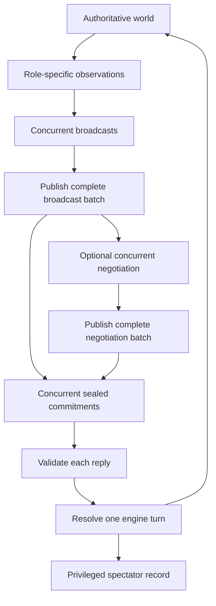

# Architecture

Parallax Relay is a local Python application, with no server, database, frontend
build, or agent framework. Pillow renders observations, Pydantic validates replies
and configuration, and httpx sends direct provider requests. The game engine
remains independent of the provider adapters.

## Modules and ownership

| Layer | Modules | Responsibility |
|---|---|---|
| Simulation | `state.py`, `engine.py` | Room state, legal consequences, scoring, terminal outcomes |
| Observation | `render.py`, `observations.py`, HUD/event helpers in `state.py` | Role-specific PNG and allowed text projection |
| Player contract | `protocol.py`, `prompts.py` | Immutable inputs, reply schemas, public rules |
| Players | `providers.py`, `agents.py`, `scripted.py` | REST adapters and explicit scripted control fixture |
| Match driver | `orchestrator.py`, `budget.py` | Phase barriers, retries, histories, reservations, stop reasons |
| Local interface | `config.py`, `play.py` | TOML/env resolution, CLI, provider-client ownership |
| Spectator output | `recording.py`, `replay_template.html` | Incremental logs, images, final summary, static viewer |
| Legacy demo | `demo.py` | Direct scripted engine driver and older replay format |

All module names above are relative to `parallax_relay/`.

## One turn

The direct broadcast-to-commit path is fast mode. Every phase within a turn uses
the same initial observation; later phases add completed message batches. Within a
phase, `asyncio.gather` waits for all roles' bounded response paths. Faster players
and retries receive no other player's same-phase response.

Each request contains the role's own PNG, HUD, private objective, recent text
history, latest private notes, and completed public messages. Old PNGs are not
resent. Histories and notes are stored separately per role. When commitments finish,
the engine applies VENT before REROUTE, then movement, then collection/unlocking,
then victory or defeat. The input world is copied before mutation.

Model JSON shape failures may retry. Schema-valid illegal moves consume the turn;
they are not repaired into better moves. See [Protocol](PROTOCOL.md) for the exact
contract, including engine enforcement of zero parameters for non-MOVE actions.

## Trust boundaries

`observe(world, role)` is the standard engine-to-player boundary. The HUD is an
explicit projection; `WorldState.snapshot()` is reserved for spectator records.
Images expose different hidden facts per role. Publicly disclosed facts and
observable consequences are shared by design; hidden-state tests are not a proof
that a fixed room cannot be learned or inferred.

Credentials are resolved by the launcher and passed to provider clients, not to
prompt builders. Provider responses and player messages are untrusted data. The
model has no shell, browser, filesystem, or external-action tools. The engine is
authoritative even if a model ignores its prompt instructions.

The adapters use fixed HTTPS endpoints, disable redirects, bound response body
size, and sanitize errors. The main replay escapes embedded data and inserts model
text using DOM text operations. These protections do not sandbox arbitrary Python
agents: code imported into the process is trusted and can access process state.

Replay files deliberately contain all observations, goals, notes, and world
snapshots. They are for a privileged spectator, not another player.

## Budgets, failures, and lifecycle

The driver reserves the entire phase's maximum retry allowance before starting any
role. Each attempt consumes one call; unused reservations are released. Missing or
partial token usage retains the cost estimate. Pricing is an estimate, not an
external billing ceiling. Unknown usage is counted explicitly.

Only the CLI scripted-mock path copies the validated settings and clears the
effective dollar cap before creating the recorder/driver. Other settings and
configured rates are retained. Mock manifests add optional `requested_settings`
after CLI overrides; existing `settings` describe execution. Live and programmatic
budget behavior is unchanged, including direct calls with scripted agents. With
known zero usage, complete pricing yields a zero estimate; incomplete pricing
continues to yield null. No shared budget API or result format changed.

A fatal provider error or a budget stop leaves the world at the last resolved
turn. Resolved world state and its in-memory record are committed together before
turn persistence. Recording/progress failures drain cooperative phase tasks, then
attempt finalization and raise `MatchExecutionError` with the partial result.
Cancellation remains cancellation, even when recording fails during cleanup.
The launcher closes provider clients in `finally`; programmatic callers own the
clients they pass to `run_match`. CLI-owned client shutdown has a five-second
cooperative timeout; secondary cleanup failures never mask an active failure.

The main recorder creates a new output directory, appends call/phase/turn JSONL,
and keeps authoritative call, completed-phase, and resolved-turn records in memory.
Finalization independently writes atomic snapshots of the three JSONL logs, result,
final state, final spectator PNG, and HTML. This repairs partial trailing writes
without duplicating events. A failed artifact does not prevent the others; the
driver permits one recovery pass after a failed initial pass. The HTML viewer is
created at finalization, not streamed. Atomic replacement is per artifact, not a
durable transaction across the run directory; storage stalls and uncooperative
in-process code are outside the bounded-attempt/cooperative-cleanup guarantee.

## Extension points

An agent implements `async respond(AgentRequest) -> ModelReply` and `async close()`.
A new provider should preserve the common contract, explicit usage/refusal status,
bounded attempts, and sanitized failures; verify its wire format independently of
its mock tests. A model or provider swap does not require an engine change.

Adding a room or role is larger work: role names, world constants, prompts,
schemas, renderer, configuration checks, fixtures, and viewer are currently coupled
to three roles and one room. No level-loading interface exists yet. Add those
capabilities only through a separately scoped design and the [roadmap](../ROADMAP.md).

There is no package-install or console-script interface. Run modules from the
checkout root. The legacy demo CLI returns an exit status and uses a unique default output path;
its `run(out: Path) -> dict` interface still requires an explicit fresh destination.
